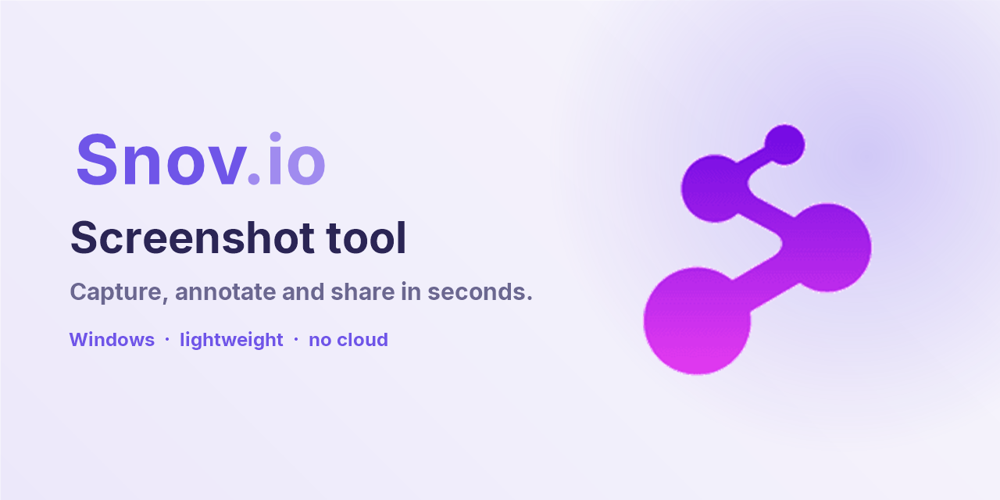

# Snov.io - Screenshot tool



A lightweight Windows screenshot tool made for the Snov.io team. Select an area, annotate it, then copy or save the image.

- Lives in the system tray.
- Works offline: no network access.
- Writes nothing to disk unless you save an image or change settings.

📖 **Full guide, tool by tool:** [docs/TUTORIAL.md](docs/TUTORIAL.md)

## Download

1. Open the **Releases** page of this repository.
2. Download `Snovio-Screenshot-Tool.exe` from the latest release.
3. Put it in a folder of your choice. The app stores `settings.json` next to the file.
4. Double-click to start. The icon appears in the system tray.

## How to use

| Action | How |
| --- | --- |
| Start a capture | `Shift + Backspace` (or the hotkey you chose in Settings) |
| Select an area | Click and drag. Drag the handles to adjust it |
| Pick a tool | Click it in the vertical bar, or press its letter: `P` pen, `L` line, `A` arrow, `R` rectangle, `E` ellipse, `M` highlighter, `T` text, `B` pixelate, `N` number |
| Pick a color | Click a color in the palette, or press `1` to `6` |
| Stroke / text size | Mouse wheel (text size while the text tool is active) |
| Undo / redo | `Ctrl + Z` / `Ctrl + Y` |
| Delete the selected item | `Delete` |
| Copy to clipboard | `Ctrl + C` or the copy button |
| Save to file | `Ctrl + S` or the save button (JPEG or PNG) |
| Close without saving | `Esc` or the **X** button |

Clicking the active tool again turns it off, so you can move or resize the selected area without drawing. The last color you used is remembered for the next capture.

## Settings

Open the tray icon menu and choose **Settings**:

- **Capture hotkey:** `Shift+BKSP`, `Shift+Insert`, `Shift+PrtScn`, or a custom key (any key, with or without Ctrl/Alt/Shift).
- **Stroke width** and **text size**.
- **Save format:** JPEG or PNG.
- **Toolbar style:** light or dark.
- **Start with Windows.**

## Build from source

Requirements: [Rust](https://rustup.rs) (stable, MSVC toolchain) on Windows.

```powershell
cargo build --release
```

The executable is created at `target\release\Snovio-Screenshot-Tool.exe`.

To build the Windows installer, install [Inno Setup 6](https://jrsoftware.org/isinfo.php) and run:

```powershell
ISCC.exe installer\Snovio-Screenshot-Tool.iss
```

The installer is created at `dist\Snovio-Screenshot-Tool-Setup.exe`.

## Project layout

- `src/` - application code (capture, overlay, editor, tools, settings, tray).
- `assets/` - icon, preview image and the bundled Inter fonts.
- `installer/` - Inno Setup script.
- `tools/` - helper scripts (icon generation).
- `docs/` - user tutorial.
