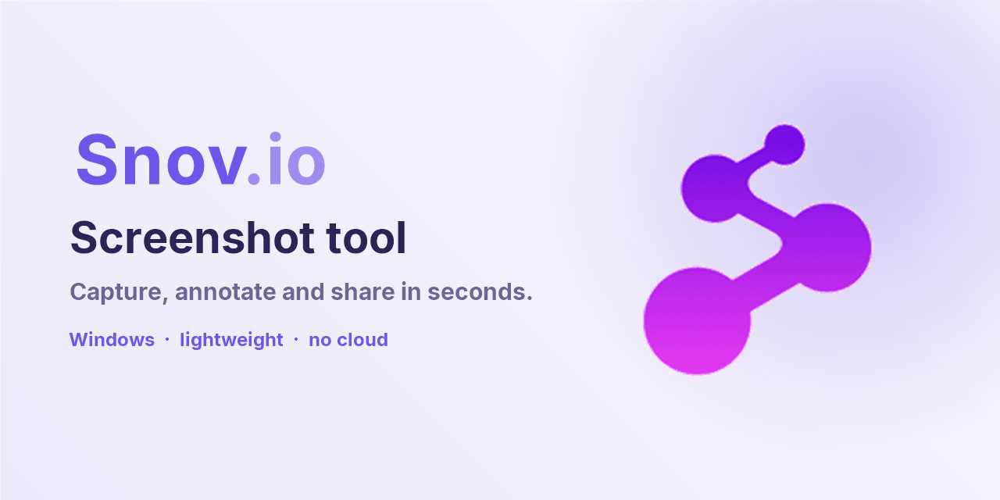

# Snov.io - Screenshot tool



Lightweight screenshot tool for Windows. Select an area, annotate it, then copy or save the image. It lives in the system tray and never writes anything to disk unless you ask it to. No network access.

📖 **Full tutorial, tool by tool:** [docs/TUTORIAL.md](docs/TUTORIAL.md)

## Download

1. Go to the [Releases](../../releases) page and download `Snovio-Screenshot-Tool.exe` from the latest version.
2. Put the file in a folder of your choice (the app keeps `settings.json` next to it) and double-click to open.
3. The app appears in the tray, near the clock.

> If Windows shows "Windows protected your PC" (SmartScreen), click **More info** and then **Run anyway**. This happens with programs that have no digital signature.

There is no installer. To stop the app, right-click the tray icon → **Exit**.

## Quick start

| What to do | How |
|---|---|
| Start a capture | **Shift + Backspace** (or the hotkey you pick in Settings) |
| Select an area | Drag with the mouse and release |
| Annotate | Pick a tool from the vertical bar next to the selection |
| Copy | Copy button in the horizontal bar, or **Ctrl + C** |
| Save to a file | Save button, or **Ctrl + S** |
| Cancel | **Esc**, or the X button in the horizontal bar |

Every tool, with examples, is described in the [tutorial](docs/TUTORIAL.md).

## Settings

Right-click the tray icon → **Settings**. There you can choose:

- **Capture hotkey:** Shift+BKSP, Shift+Insert, Shift+PrtScn, or **Custom**. For Custom, click the field and press the combination you want (it needs Ctrl, Alt or Shift, or an F key).
- **Default color:** the color tools start with. The default is Snov.io purple.
- **Stroke width** and **Text size:** line thickness and text size, with a live preview.
- **Save format:** JPEG (default) or PNG.
- **Toolbar style:** *Conservative (light)*, the light toolbar, or *Modern (dark)*, the dark toolbar.
- **Start with Windows:** opens the app when you sign in.

Changes apply to the next capture. If the hotkey you chose is already used by another program, the app falls back to Print Screen and tells you.

## Building from source

Requirements: [Rust](https://rustup.rs) (stable toolchain) and Windows 10 or 11.

```
cargo build --release          # creates target\release\Screenshotter.exe
cargo test                     # runs the tests
```

The Inter font is embedded in the executable (`assets/fonts/`, SIL Open Font License, see `assets/fonts/LICENSE-Inter.txt`).

## License

Code and brand: internal use by Snov.io. The Inter font is licensed under the SIL Open Font License.
